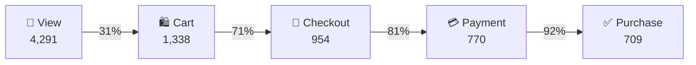

<h1 align="center">🛒 Ecommerce_User_Event_Analysis</h1>

<p align="center">
  
  
  
</p>

---

An end-to-end SQL data analytics project using real e-commerce data.

In this project, we are performing **Sales Funnel Analysis**, a commonly used data analysis technique that helps businesses understand customer behaviour and identify bottlenecks in the purchasing journey.

Sales funnel analysis tracks a user's journey on an e-commerce website, from their initial interaction with the platform to the final purchase. The primary objective is to identify stages where users drop off, calculate conversion rates, and uncover opportunities to improve the overall purchasing experience.

The funnel consists of five key stages:

1. **Page View:** Users visit the website and start browsing products.
2. **Add to Cart:** Users show purchase intent by selecting products and adding them to their cart.
3. **Checkout Start:** Users proceed to the checkout process to place their order.
4. **Payment Information:** Users enter their payment details to complete the transaction.
5. **Purchase:** Users successfully complete the transaction.

By counting the unique users at each stage, we can track how the number of users changes throughout the funnel, measure conversion rates between consecutive stages, and identify where the biggest drop-offs occur.



### ⚡ Key Metrics at a Glance

| Visitors | Buyers | Orders | Revenue | Avg. Order Value | Revenue / Visitor |
|:-------:|:------:|:------:|:-------:|:----------------:|:-----------------:|
| **4,291** | **709** | **709** | **76,191.82** | **107.46** | **17.76** |

---

## Step 1: Funnel Stage Definition and Conversion Rate Analysis

We start by defining the five stages of the sales funnel and calculating the conversion rate between each consecutive stage.

* Page View to Add-to-Cart Conversion Rate: Measures the percentage of website visitors who viewed products and subsequently added products to their cart.
* Cart to Checkout Conversion Rate: Measures the percentage of users who added products to their cart and proceeded to checkout.
* Checkout to Purchase Conversion Rate: Measures the percentage of users who initiated checkout and successfully completed their purchase.

We also calculate the Overall Conversion Rate, which tells us what percentage of the total website visitors actually completed a purchase.

This analysis helps us understand how effectively the platform converts visitors into paying customers and identify the stages where the maximum drop-offs occur.

### 📊 Results

| Stage | Users | Step Conversion |
|:------|------:|----------------:|
| 1. View | 4,291 | — |
| 2. Cart | 1,338 | 31% of views |
| 3. Checkout | 954 | 71% of carts |
| 4. Payment | 770 | 81% of checkouts |
| 5. Purchase | 709 | 92% of payments |

**💡 Insight:** The biggest drop-off is at the very top: only **31%** of visitors add something to their cart. Once users reach checkout, they complete it, with every later step keeping 71% to 92% of users. End to end, about **16.5%** of visitors buy (709 / 4,291).

> **Note:** The query splits "checkout to purchase" into two steps, checkout → payment (81%) and payment → purchase (92%). The column named `overall_conversion_rate` in the query is the payment → purchase step. The true overall rate (view → purchase) is ≈ 16.5%.

---

## Step 2: Conversion Channel Analysis

Next, we analyse whether the traffic source through which users arrive at the website has an impact on their purchasing behaviour.

We have four traffic sources:

* Social
* Email
* Paid Ads
* Organic

We group users based on their traffic source and calculate the number of visitors, cart additions, purchases, and conversion rates for each channel.

From our analysis, we observe that Email has the highest conversion rate, whereas Social Media brings approximately 30% of the website traffic but has a comparatively low conversion rate.

This suggests that although Social Media generates significant traffic, it may not be attracting visitors with equally strong purchase intent.

A possible business recommendation would be to evaluate reallocating a portion of the marketing budget from Social Media towards Email campaigns, while testing the impact on conversions before making a major budget shift.

### 📊 Results

| Traffic Source | Views | Carts | Purchases | View → Cart | Cart → Purchase | Overall Conversion |
|:---------------|------:|------:|----------:|------------:|----------------:|-------------------:|
| Social         | 1,261 | 171   | 84        | 14%         | 49%             | **7%**             |
| Email          | 449   | 283   | 152       | 63%         | 54%             | **34%** 🏆         |
| Paid Ads       | 824   | 306   | 173       | 37%         | 57%             | **21%**            |
| Organic        | 1,757 | 578   | 300       | 33%         | 52%             | **17%**            |

**💡 Insight:**

- 📧 **Email converts best** at 34%, nearly 5× social.
- 📱 **Social drives about 30% of all traffic** but converts at only 7%, the lowest of any channel.
- 🌱 **Organic** is the largest source (about 41% of visits) with a solid 17% conversion.
- 💰 **Paid Ads** have the highest cart-to-purchase rate (57%).

---

## Step 3: Time-to-Conversion Analysis

In the next step, we analyse how much time users take to move between different stages of the purchasing funnel.

We calculate:

* Average time from Page View to Add to Cart.
* Average time from Add to Cart to Purchase.
* Average total time from Page View to Purchase.

Our analysis shows that the average overall purchasing journey takes approximately 24 minutes, with users taking around 12 minutes to move from viewing a product to adding it to their cart.

This gives us an opportunity to investigate whether the product discovery experience can be improved. For example, users might be taking longer to find relevant products, suggesting that search results, product recommendations, or product visibility could be optimised.

### 📊 Results

| Journey Segment | Average Time |
|:----------------|:------------:|
| Page View → Add to Cart | ~12 min |
| Page View → Purchase (total) | ~24 min |

---

## Step 4: Revenue Analysis and Key Business Metrics

Finally, we calculate key revenue-related metrics to understand the platform's financial performance.

These include:

* Average Order Value (AOV): Average revenue generated per order.
* Average Revenue Per Buyer: Average revenue generated by each purchasing customer.
* Average Revenue Per Visitor: Average revenue generated per website visitor.

These metrics help us understand not just how many users are converting, but also how much revenue the platform generates from its customers and overall website traffic.

### 📊 Results

| Total Visitors | Total Buyers | Total Orders | Total Revenue | Avg. Order Value | Avg. Revenue / Buyer | Avg. Revenue / Visitor |
|--------------:|-------------:|-------------:|--------------:|-----------------:|---------------------:|-----------------------:|
| 4,291 | 709 | 709 | 76,191.82 | 107.46 | 107.46 | 17.76 |

**💡 Insight:** Every buyer placed exactly one order (709 buyers = 709 orders), so there is no repeat purchasing yet in this dataset.

---

## ✅ Final Recommendations

| # | Recommendation | Why |
|:-:|:---------------|:----|
| 1 | **Stop over-investing in Social for sales.** Shift budget from "Traffic" objectives toward Retargeting or Lead Gen to capture emails. | Social drives ~30% of traffic but converts at only 7%. |
| 2 | **Double down on Email marketing.** Add an email-capture popup for high-volume social visitors. | Email converts at 34%, the highest of any channel. |
| 3 | **Don't touch the checkout flow.** Focus optimisation on the view → cart step instead. | Checkout steps convert at 71–92%, so the payment flow is frictionless. |

### 🧮 Unit Economics Guardrails

- Our average order value is around 107, so for immediate measures: **if AOV < CAC, we lose money.**
- Our **Customer Lifetime Value must be at least 3× higher than our acquisition cost.**

---

## 🗂️ Repository Structure

```
Ecommerce_User_Event_Analysis/
├── ecommerce_funnel_analysis.sql   # All queries (exploration, funnel, channels, time, revenue)
└── README.md                       # Project documentation
```

---

## Closing Note

This was a step-by-step walkthrough of how sales funnel analysis is generally performed, starting from understanding user progression and conversion rates to analysing traffic sources, identifying potential bottlenecks, and evaluating revenue performance.

The ultimate objective is to use data to understand customer behaviour, identify areas of improvement, and support better business and marketing decisions.
